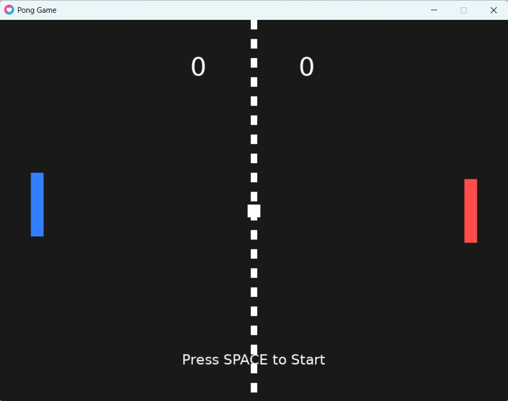
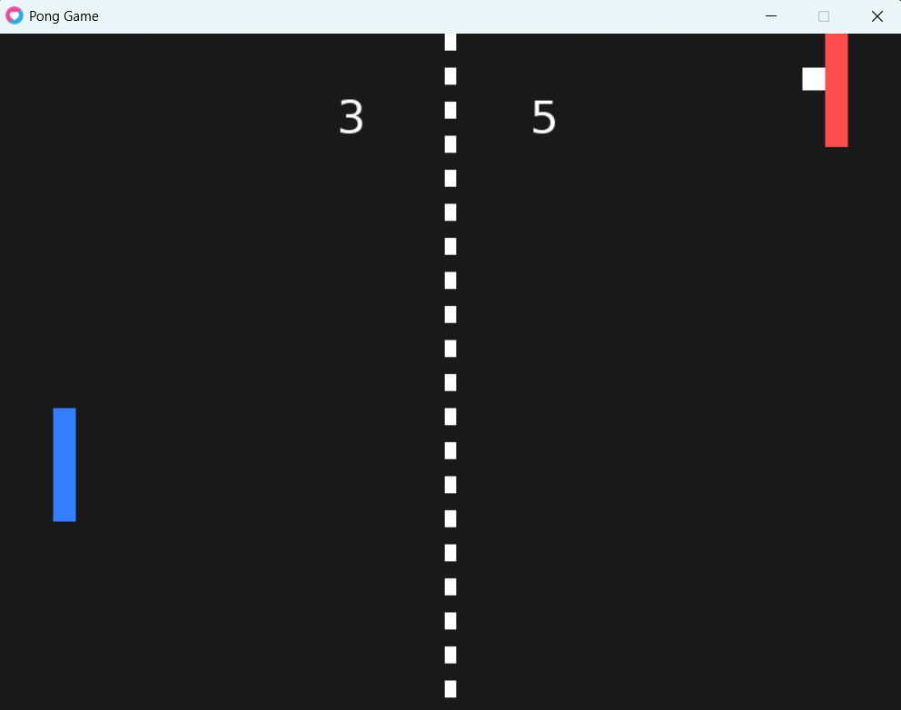

# Pong Game - Love2D 🎮

## Student Information
- **Full Name:** [Masa Thabet Atallah]
- **Class/Section:** [Cap-Ai-Gaming-fall-2026/8-9]

## Game Description
This project is a two-player Pong game developed using Lua and the Love2D framework. Each player controls a paddle to hit the moving ball and prevent it from passing their side. The ball bounces off the top and bottom walls and both paddles using collision detection. The game includes a scoring system, ball speed increases after paddle collisions, and automatic ball resets after each point.

## How to Run
1. Download and install Love2D from https://love2d.org/.
2. Clone or download this repository.
3. Open the project folder.
4. Run the game using the command:

`love .`

On Windows, you can also run the game using `run.bat` if Love2D is installed at the path specified in that file.

## Game Controls

| Player | Key | Action |
|---|---|---|
| Player 1 (Left) | W | Move Up |
| Player 1 (Left) | S | Move Down |
| Player 2 (Right) | Up Arrow | Move Up |
| Player 2 (Right) | Down Arrow | Move Down |
| Start Game | Space | Start the game |

## My Own Changes

### 1. Different Paddle Colors
I changed the paddle colors to make the players easier to distinguish. The left paddle is blue, and the right paddle is red.

### 2. Press Space to Start
I added a feature that allows players to start the game by pressing the Space key. The ball remains stationary in the center until Space is pressed. After the game starts, the ball automatically resets and continues moving after each point without requiring another key press.

## Game Screenshots

### Game Start

### Gameplay

## Game Demo

[Watch the Pong Game Demo](demo/game-demo2.mp4)

## Technologies Used
- Lua
- Love2D
- Git
- GitHub
